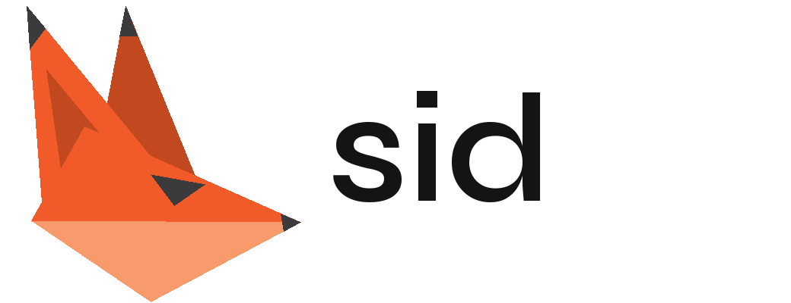
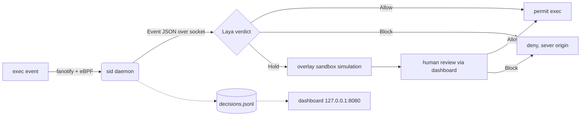

<div align="center">



# sid

**Host-wide exec capture that holds uncertain commands for isolated simulation and human approval, backed by a local Allow / Hold / Block classifier.**


-ff69b4)


</div>

---

## Table of Contents

- [About](#about)
- [How It Works](#how-it-works)
- [Features](#features)
- [Built With](#built-with)
- [Getting Started](#getting-started)
  - [Prerequisites](#prerequisites)
  - [Installation](#installation)
- [Usage & Testing](#usage--testing)
- [Repository Layout](#repository-layout)
- [Documentation](#documentation)
- [License](#license)

## About

sid captures Linux exec events, reviews uncertain commands through isolated simulation and
human approval, and prepares data for a local Allow/Hold/Block classifier. The daemon calls
the model interface in `src/jev.hpp`. `src/jev_laya.cpp` starts a persistent Laya child
before capture and sends Event JSON to it over a private socket. The child uses the same
renderer and verdict question as training and evaluation, so the path that ships is the path
that was tested.

Everything runs locally. There are no cloud calls in the decision path.

<p align="right">(<a href="#table-of-contents">back to top</a>)</p>

## How It Works



The daemon needs the model to start, and it fails open if the model dies (the service runs
with `Restart=always`). A Block verdict severs the command's origin.

<p align="right">(<a href="#table-of-contents">back to top</a>)</p>

## Features

- **Host-wide capture:** every exec is seen through fanotify and eBPF under systemd.
- **Local classifier:** Laya returns Allow, Hold, or Block with no network call in the decision path.
- **Isolated simulation:** a held command runs in an overlay sandbox before anyone reviews it.
- **Human in the loop:** a web dashboard shows held commands and records each verdict.
- **Fails open:** the daemon restarts on its own and will not wedge the host.
- **Reproducible pipeline:** dataset generation, annotation, fine-tuning, and evaluation share one renderer.

<p align="right">(<a href="#table-of-contents">back to top</a>)</p>

## Built With

- **C++17** for the capture daemon, simulation helper, and model interface (`src/`)
- **eBPF, libbpf, bpftool** for kernel-side exec capture
- **Python and PyTorch** for the Laya worker and the dataset and training tooling
- **Node.js** for the review dashboard (`frontend/`)
- **systemd** for service management (`sid.service`, `sid-web.service`)

<p align="right">(<a href="#table-of-contents">back to top</a>)</p>

## Getting Started

`./sandbox.sh` is the demo. The steps below install host-wide capture for real. Run them as root.

### Prerequisites

* A bare-metal or VM Linux host (x86_64 or arm64), not Docker Desktop.
* Kernel BTF and `CONFIG_FANOTIFY_ACCESS_PERMISSIONS=y`.
* Build and model dependencies:
  ```sh
  sudo apt-get install -y build-essential clang llvm bpftool libbpf-dev libelf-dev \
      zlib1g-dev linux-tools-common linux-tools-generic python3-venv nodejs npm git-lfs
  ```

### Installation

1. Pull the bundled checkpoint.
   ```sh
   git lfs pull
   ```
2. Install the model (add `--index-url https://download.pytorch.org/whl/cu128` for an NVIDIA GPU).
   ```sh
   python3 -m venv /opt/sid-venv && /opt/sid-venv/bin/pip install laya torch
   ```
3. Build, install, and start the capture daemon.
   ```sh
   sudo bash linux/install.sh "$PWD"
   ```
4. Install the dashboard on `127.0.0.1:8080`.
   ```sh
   make -C frontend install
   sudo touch /var/log/sid/decisions.jsonl && sudo chown nobody /var/log/sid/decisions.jsonl
   sudo install -m644 frontend/sid-web.service /etc/systemd/system/ && sudo systemctl enable --now sid-web
   ```
5. Point the daemon at the model in `/etc/sid/model.env`, then run `sudo systemctl restart sid`.
   ```sh
   SID_MODEL_PYTHON=/opt/sid-venv/bin/python
   SID_MODEL_WORKER=/usr/local/lib/sid/runtime/laya_worker.py
   SID_LAYA_CHECKPOINT=/opt/sid/checkpoint
   SID_LAYA_DEVICE=auto          # cuda when present, else cpu
   ```
6. Confirm capture is live. `journalctl -u sid -n 20 -o cat` should show `capture ACTIVE`.

> **Remote operators:** put the dashboard behind an authenticating proxy.

<p align="right">(<a href="#table-of-contents">back to top</a>)</p>

## Usage & Testing

Test the live model hook without capturing or executing the supplied command:

```sh
make build/sid-model-check
build/sid-model-check -- bash -c 'cat README.md'
```

The default checkpoint is the selected one (see [Repository Layout](#repository-layout)). Set
`SID_LAYA_CHECKPOINT` to an absolute directory to test a later fine-tune. The worker uses
`.venv/bin/python` when available and selects CUDA when available. All settings live in
[runtime/README.md](runtime/README.md).

Run the command-review, data integrity, and model protocol tests together:

```sh
make check
# Include the optional tokenizer regression test using the local environment:
make check PYTHON=.venv/bin/python
```

- `make test` runs the C++ command-review tests. Overlay and whiteout cases need root and skip otherwise.
- `make test-data` runs the Python data tests.
- `make test-model` runs the model protocol tests with fake workers.

None of these suites need a GPU or checkpoint. `make` builds the Linux daemon, simulation
helper, and eBPF program, and needs a C++17 compiler, clang, bpftool, libbpf, libelf, zlib,
and kernel BTF. `sandbox.sh` runs the isolated Docker environment. `linux/install.sh` installs
the system-wide capture on a Linux host.

<p align="right">(<a href="#table-of-contents">back to top</a>)</p>

## Repository Layout

The approved dataset is `.data/pilot-v2/release/`. The selected checkpoint is
`.data/pilot-v2/finetune-04/checkpoint/`. Newer expansion files are proposals and stay
separate. `.data/`, `models/`, and `.venv/` are ignored local symlinks.

| Path | What's there |
| --- | --- |
| `src/` | Capture daemon, simulation helper, and the model interface (`jev.hpp`, `jev_laya.cpp`) |
| `linux/` | System-wide install (`install.sh`, `sid.service`) |
| `frontend/` | Review dashboard and brand assets |
| `runtime/` | Model startup and configuration |
| `dataset/` | Data generation, annotation, training, and evaluation |
| `demos/` | `exposed-shell` and `try-to-hack-me` demos |
| `sandbox/`, `sandbox.sh` | Isolated Docker demo environment |

<p align="right">(<a href="#table-of-contents">back to top</a>)</p>

## Documentation

- [Data generation, annotation, training and evaluation](dataset/README.md)
- [Model startup and configuration](runtime/README.md)
- [Dataset and experiment history](dataset/HISTORY.md)

<p align="right">(<a href="#table-of-contents">back to top</a>)</p>

## License

No license file is included in this repository yet, so default copyright applies and no usage
rights are granted. Add a `LICENSE` file to set the terms.

<p align="right">(<a href="#table-of-contents">back to top</a>)</p>
