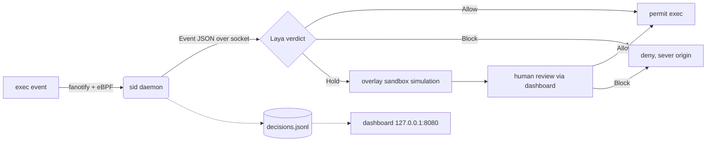

<div align="center">


# sid

**Host-wide exec capture that holds uncertain commands for isolated simulation and human approval, backed by a local Allow / Hold / Block classifier.**


-ff69b4)


</div>

---

## Table of Contents

- [About](#about)
- [How It Works](#how-it-works)
- [Features](#features)
- [Built With](#built-with)
- [Getting Started](#getting-started)
  - [Prerequisites](#prerequisites)
  - [Installation](#installation)
- [Usage & Testing](#usage--testing)
- [Repository Layout](#repository-layout)
- [Documentation](#documentation)
- [Roadmap](#roadmap)
- [License](#license)

## About

sid (System Intrusion Detection) judges every command on a host before it runs. More and
more commands now execute with no human watching: a 2026 honeypot study, "Ghost Without
Shell," found that 99.23% of logged-in SSH sessions were a script issuing a single command
and then disconnecting, with nobody at a keyboard. Autonomous agents run long sequences of
shell commands on their own, and one unauthorized command can escalate from a foothold to
full control of a machine. sid is a local, offline first line of defense against that.

Each exec is captured before it runs and sent to a fine-tuned Laya model along with its
context: the parent process and the files it touches. The model returns one of three
verdicts. Allow runs the command. Block stops a command that is clearly malicious. Hold
diverts the command to a sandbox, where sid simulates it, watches what it does, and hands it
to a person for review. Verdicts come back within milliseconds.

Everything runs on the machine itself. There are no cloud calls in the decision path, and no
special hardware is needed: the model is small enough to run on an average laptop, which
suits cost-sensitive and privacy-sensitive operators (for example, a nonprofit keeping its
site from being taken down). A minimal web dashboard shows every decision, offers user and
admin overrides, and has a detailed statistics view.

The daemon calls the model interface in `src/jev.hpp`. `src/jev_laya.cpp` starts a persistent
Laya child before capture begins and sends each Event as JSON over a private socket. Dataset
generation, training, evaluation, and this live path share one renderer and one verdict
prompt, so the model sees the same input in production that it saw during training.

<p align="right">(<a href="#table-of-contents">back to top</a>)</p>

## How It Works



The daemon needs the model to start, and it fails open if the model dies (the service runs
with `Restart=always`). On a Block verdict, sid treats the command's whole spawning context
as compromised and shuts it down. If a web application spawns a malicious shell command, sid
assumes the shell, and possibly the application that launched it, has been taken over through
an unknown vector, rather than just dropping the one command.

<p align="right">(<a href="#table-of-contents">back to top</a>)</p>

## Features

- **Host-wide capture:** fanotify (`FAN_OPEN_EXEC_PERM`) pauses every program launch until sid answers, and an eBPF probe supplies the exec record for context. Every userspace command is seen.
- **Local classifier:** the fine-tuned Laya model returns Allow, Hold, or Block with no network call in the decision path.
- **Isolated simulation:** a held command runs in an overlayfs sandbox, so its effects never touch the real filesystem, before a person reviews it.
- **Human in the loop:** the dashboard shows held commands and records each verdict as a yes or no decision.
- **Containment on Block:** a blocked command's spawning context is treated as compromised and shut down, not just denied.
- **Learns from history:** past commands and their decisions feed back into the context sid sends the model on later calls.
- **Fails open:** the daemon runs under systemd with `Restart=always` and will not wedge the host if the model dies.
- **Reproducible pipeline:** dataset generation, annotation, fine-tuning, and evaluation share the renderer used at runtime.

<p align="right">(<a href="#table-of-contents">back to top</a>)</p>

## Built With

- **C++17** for the capture daemon, simulation helper, and model interface (`src/`)
- **eBPF** (libbpf, bpftool) for kernel-side exec capture, with **fanotify** as the permission gate and **seccomp-notify** for containerized sessions where eBPF is unavailable
- **Python and PyTorch** for the Laya worker and the dataset and training tooling
- **Laya**, the local decision model, fine-tuned on roughly 11,000 unique commands and contexts
- **overlayfs** for sandboxed simulation of held commands
- **Atomic Red Team** and **GTFOBins** (offensive) and **NL2Bash** (benign) as training data sources
- **Node.js** for the review dashboard (`frontend/`)
- **systemd** for service management (`sid.service`, `sid-web.service`)

<p align="right">(<a href="#table-of-contents">back to top</a>)</p>

## Getting Started

`./sandbox.sh` is the demo. The steps below install host-wide capture for real. Run them as root.

### Prerequisites

* A bare-metal or VM Linux host (x86_64 or arm64), not Docker Desktop.
* Kernel BTF and `CONFIG_FANOTIFY_ACCESS_PERMISSIONS=y`.
* Build and model dependencies:
  ```sh
  sudo apt-get install -y build-essential clang llvm bpftool libbpf-dev libelf-dev \
      zlib1g-dev linux-tools-common linux-tools-generic python3-venv nodejs npm git-lfs
  ```

### Installation

1. Pull the bundled checkpoint.
   ```sh
   git lfs pull
   ```
2. Install the model (add `--index-url https://download.pytorch.org/whl/cu128` for an NVIDIA GPU).
   ```sh
   python3 -m venv /opt/sid-venv && /opt/sid-venv/bin/pip install laya torch
   ```
3. Build, install, and start the capture daemon.
   ```sh
   sudo bash linux/install.sh "$PWD"
   ```
4. Install the dashboard on `127.0.0.1:8080`.
   ```sh
   make -C frontend install
   sudo touch /var/log/sid/decisions.jsonl && sudo chown nobody /var/log/sid/decisions.jsonl
   sudo install -m644 frontend/sid-web.service /etc/systemd/system/ && sudo systemctl enable --now sid-web
   ```
5. Point the daemon at the model in `/etc/sid/model.env`, then run `sudo systemctl restart sid`.
   ```sh
   SID_MODEL_PYTHON=/opt/sid-venv/bin/python
   SID_MODEL_WORKER=/usr/local/lib/sid/runtime/laya_worker.py
   SID_LAYA_CHECKPOINT=/opt/sid/checkpoint
   SID_LAYA_DEVICE=auto          # cuda when present, else cpu
   ```
6. Confirm capture is live. `journalctl -u sid -n 20 -o cat` should show `capture ACTIVE`.

> **Remote operators:** put the dashboard behind an authenticating proxy.

<p align="right">(<a href="#table-of-contents">back to top</a>)</p>

## Usage & Testing

Test the live model hook without capturing or executing the supplied command:

```sh
make build/sid-model-check
build/sid-model-check -- bash -c 'cat README.md'
```

The default checkpoint is the selected one (see [Repository Layout](#repository-layout)). Set
`SID_LAYA_CHECKPOINT` to an absolute directory to test a later fine-tune. The worker uses
`.venv/bin/python` when available and selects CUDA when available. All settings live in
[runtime/README.md](runtime/README.md).

Run the command-review, data integrity, and model protocol tests together:

```sh
make check
# Include the optional tokenizer regression test using the local environment:
make check PYTHON=.venv/bin/python
```

- `make test` runs the C++ command-review tests. Overlay and whiteout cases need root and skip otherwise.
- `make test-data` runs the Python data tests.
- `make test-model` runs the model protocol tests with fake workers.

None of these suites need a GPU or checkpoint. `make` builds the Linux daemon, simulation
helper, and eBPF program, and needs a C++17 compiler, clang, bpftool, libbpf, libelf, zlib,
and kernel BTF. `sandbox.sh` runs the isolated Docker environment. `linux/install.sh` installs
the system-wide capture on a Linux host.

<p align="right">(<a href="#table-of-contents">back to top</a>)</p>

## Repository Layout

The approved dataset is `.data/pilot-v2/release/`. The selected checkpoint is
`.data/pilot-v2/finetune-04/checkpoint/`. Newer expansion files are proposals and stay
separate. `.data/`, `models/`, and `.venv/` are ignored local symlinks.

| Path | What's there |
| --- | --- |
| `src/` | Capture daemon, simulation helper, and the model interface (`jev.hpp`, `jev_laya.cpp`) |
| `linux/` | System-wide install (`install.sh`, `sid.service`) |
| `frontend/` | Review dashboard and brand assets |
| `runtime/` | Model startup and configuration |
| `dataset/` | Data generation, annotation, training, and evaluation |
| `demos/` | `exposed-shell` and `try-to-hack-me` demos |
| `sandbox/`, `sandbox.sh` | Isolated Docker demo environment |

<p align="right">(<a href="#table-of-contents">back to top</a>)</p>

## Documentation

- [Data generation, annotation, training and evaluation](dataset/README.md)
- [Model startup and configuration](runtime/README.md)
- [Dataset and experiment history](dataset/HISTORY.md)

<p align="right">(<a href="#table-of-contents">back to top</a>)</p>

## Roadmap

- Harden sid against attacks aimed at sid itself. The current threat model assumes userspace
  adversaries; an attacker already running at kernel level has the same reach as sid and
  could disable it.
- Expand the training data, including commands and context drawn from Capture-the-Flag
  write-ups, which record real attacker commands in their original setting.

<p align="right">(<a href="#table-of-contents">back to top</a>)</p>

## License

No license file is included in this repository yet, so default copyright applies and no usage
rights are granted. Add a `LICENSE` file to set the terms.

<p align="right">(<a href="#table-of-contents">back to top</a>)</p>
